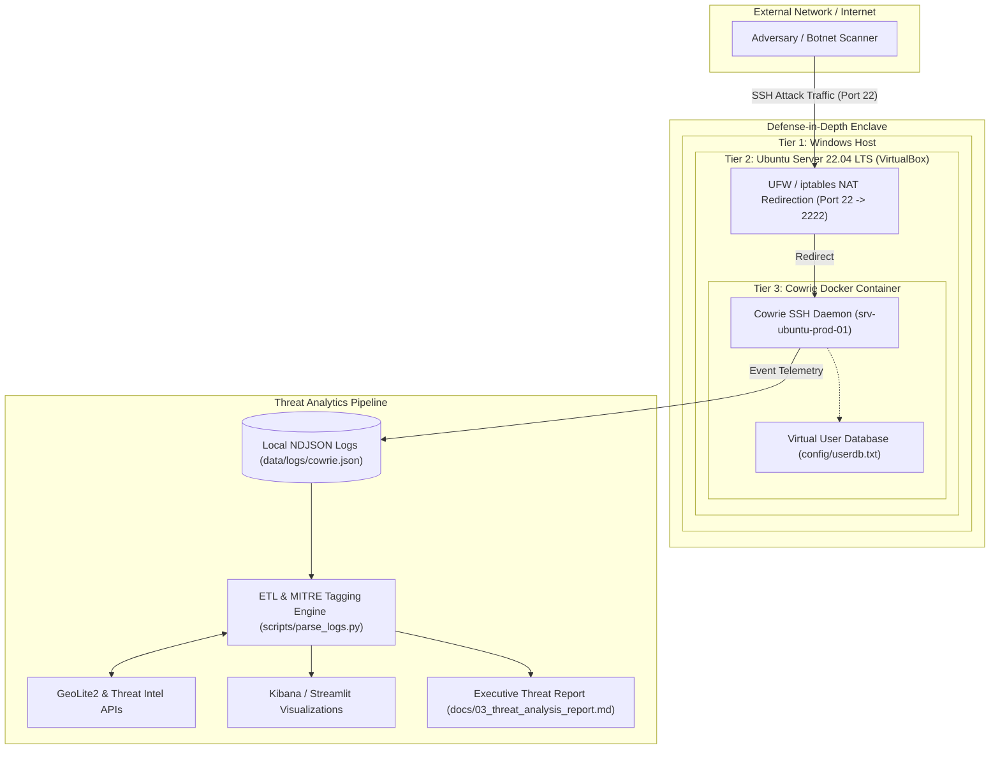

# Enterprise SSH Honeypot & Threat Intelligence Engine

[](https://opensource.org/licenses/MIT)
[](https://www.python.org/)
[](https://www.docker.com/)
[](https://attack.mitre.org/)
[](https://gdpr-info.eu/recitals/no-49/)

> **A portfolio cybersecurity project that deploys, hardens, analyzes, and visualizes an enterprise low-interaction SSH honeypot, combining hands-on Threat Intelligence (MITRE ATT&CK, GeoIP) with Information Systems Governance (RGPD Recital 49, ISO 27001).**

---

## 🎯 In One Sentence
**The Enterprise SSH Honeypot** simulates a vulnerable Linux server within an isolated multi-tier container environment, intercepts real-world botnet brute-force traffic, enriches telemetry against threat intelligence APIs, and translates raw attacker behaviors into actionable MITRE ATT&CK TTPs and executive risk reports.

---

## 🏗️ What It Actually Does
1. **Traps Adversaries:** Emulates a realistic Ubuntu server on SSH (port 22) using [Cowrie](https://github.com/cowrie/cowrie) with simulated authentication databases and virtual filesystems.
2. **Safely Contains Attacks:** Leverages a strict three-tier defense-in-depth isolation boundary:
   $$\text{Windows Host} \longrightarrow \text{Isolated Linux VM} \longrightarrow \text{Hardened Docker Sandbox}$$
3. **Automates Telemetry Ingestion:** Processes high-velocity NDJSON logs (`cowrie.json`) using a custom Python ETL pipeline.
4. **Enriches & Maps Threat Intel:** Enriches malicious IPs with Geolocation (MaxMind GeoIP2) and maps captured commands directly to **MITRE ATT&CK Enterprise Matrix** techniques.
5. **Provides Dual Visualizations:** Supplies pre-built Kibana dashboards and terminal reports for SOC analyst visibility.

---

## 🏛️ System Architecture



---

## 🧠 The MGSI & Governance Angle
Unlike standard technical tutorials that simply spin up a honeypot, this project applies **Information Systems Governance (MGSI)** principles:

- **RGPD / GDPR Recital 49 Compliance:** Demonstrates how capturing and processing malicious IP addresses is legally justified under *Article 6(1)(f)* and *Recital 49* ("legitimate interest in ensuring network and information security").
- **Data Privacy & Git Hygiene:** Enforces a strict `.gitignore` architecture preventing live adversary IP databases and payload binaries from leaking to public version control.
- **ISO/IEC 27001:2022 Controls Alignment:**
  - **A.8.16 (Monitoring Activities):** Continuous external anomaly and threat monitoring.
  - **A.8.20 (Network Security):** Segregation of honeypot network segments from corporate infrastructure.
  - **A.8.23 (Information Security in Network Services):** Verification of service isolation.

---

## 🛡️ MITRE ATT&CK® Enterprise Mapping

Every intercepted event is mapped to attacker Tactics, Techniques, and Procedures:

| Tactic | Technique ID | Technique Name | Intercepted Behavior |
| :--- | :--- | :--- | :--- |
| **Credential Access** | `T1110.001` | Brute Force: Password Guessing | Automated dictionary attempts on `root`, `admin` |
| **Defense Evasion** | `T1078` | Valid Accounts | Interactive logins using seeded credentials |
| **Discovery** | `T1082` | System Information Discovery | Attacker commands: `uname -a`, `cat /proc/cpuinfo` |
| **Discovery** | `T1016` | System Network Config Discovery | Attacker commands: `ifconfig`, `ip a`, `netstat` |
| **Discovery** | `T1033` | System Owner/User Discovery | Attacker commands: `whoami`, `id`, `w` |
| **Command & Control** | `T1105` | Ingress Tool Transfer | Automated malware staging: `wget http://.../bins` |
| **Defense Evasion** | `T1070.004` | File Deletion | Anti-forensics: `rm -rf /var/log/*`, `history -c` |

---

## 🛠️ Technology Stack

- **Honeypot Core:** [Cowrie](https://github.com/cowrie/cowrie) (Python/Twisted-based low-interaction SSH/Telnet honeypot).
- **Containerization & Orchestration:** Docker, Docker Compose, Linux namespaces.
- **Operating System & Network:** Ubuntu Server 22.04 LTS, iptables, UFW, Bash scripting.
- **Data Processing & Analytics:** Python 3.10+, Pandas, MaxMind GeoIP2.
- **Visualization:** Kibana 7.x/8.x (Saved Objects export included), Streamlit / Plotly.
- **Standards & Frameworks:** MITRE ATT&CK, GDPR Recital 49, ISO 27001:2022.

---

## ⚡ Quickstart Guide

### 1. Clone Repository & Setup Environment
```bash
git clone https://github.com/secbymorchid/ssh-honeypot-project.git
cd ssh-honeypot-project
```

### 2. Launch Honeypot via Docker Compose
```bash
docker compose up -d
```
Verify the container is active:
```bash
docker compose ps
docker compose logs -f cowrie
```

### 3. Test or Generate Synthetic Telemetry
To test the analysis pipeline immediately without waiting for external botnets:
```bash
python scripts/parse_logs.py --generate-sample
```

### 4. Process Live Telemetry & Generate Threat Report
```bash
python scripts/parse_logs.py --input data/logs/cowrie.json --output data/threat_intelligence_report.json
```

---

## 📂 Repository Structure

```plaintext
ssh-honeypot-project/
├── .gitignore                          # Strict exclusion of live attacker logs & telemetry
├── docker-compose.yml                  # Production-ready Cowrie container orchestration
├── LICENSE                             # MIT Open Source License
├── README.md                           # Master project documentation & portfolio showcase
├── requirements.txt                    # Python dependencies (pandas, geoip2, requests)
│
├── config/                             # Honeypot behavior configurations
│   ├── cowrie.cfg                      # Emulated system specs, banner & logging config
│   └── userdb.txt                      # Seeded honey credentials for interactive shell capture
│
├── dashboards/                         # Visual analytics definitions
│   └── kibana_dashboard_export.ndjson  # Pre-built Kibana dashboards (top IPs, commands, geo)
│
├── data/                               # Local isolated storage (Git-ignored)
│   └── .gitkeep                        # Maintains directory structure
│
├── docs/                               # Engineering documentation & risk assessments
│   ├── 01_architecture.md              # Defense-in-depth model, MITRE mapping & GDPR rationale
│   ├── 02_setup_guide.md               # Complete VM provisioning & network hardening guide
│   └── 03_threat_analysis_report.md    # Executive-grade Threat Intelligence Report
│
└── scripts/                            # Operational automation & data pipelines
    ├── setup_environment.sh            # Automated VM setup script (Docker, firewall, deps)
    ├── start_honeypot.sh               # Health check and lifecycle management
    └── parse_logs.py                   # Threat Intel parser & MITRE ATT&CK mapping engine
```

---

## 💼 Why It Matters for Your Career
This project proves you are not merely a student who memorizes cybersecurity concepts, but a **Security & Governance Professional** who can:
1. **Architect secure, isolated infrastructure** that protects enterprise assets from unauthorized compromise.
2. **Bridge technical threat operations (SecOps) with high-level Governance & Compliance (ISO 27001, RGPD).**
3. **Analyze live telemetry** and distill complex technical attack vectors into actionable executive intelligence.
